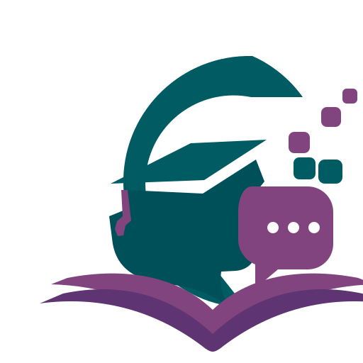

# <div align="center">EDUMENTORYA ONE</div>

<div align="center">
  
  <p><strong>« One student. One AI mentor. One path to mastery. »</strong></p>
</div>

---

## 🏛️ Présentation du Projet

**EDUMENTORYA ONE** est une plateforme éducative d'élite conçue spécifiquement pour les étudiants d'Afrique de l'Ouest (Bénin). Elle fusionne l'intelligence artificielle avancée avec les ressources académiques locales pour offrir un accompagnement personnalisé, accessible et haut de gamme.

L'objectif est de briser les barrières de l'encadrement académique en centralisant cours, épreuves passées et tutorat intelligent au sein d'une interface élégante et intuitive.

---

## ✨ Fonctionnalités Clés

### 🧠 Tuteur IA Académique
Un mentor disponible 24/7 capable de fournir des démonstrations mathématiques et algorithmiques étape par étape. Il analyse votre progression et propose des exercices ciblés pour renforcer vos points faibles.

### 📸 Correction OCR Intégrée
Envoyez une photo ou un PDF de votre devoir. Notre IA analyse la copie, identifie les erreurs méthodologiques, attribue une note formative et propose des pistes d'amélioration immédiates.

### 📚 Bibliothèque d'Annales
Une archive exhaustive des épreuves officielles (UAC, EPAC, ENEAM, BAC) avec corrigés types. Recherche par matière, niveau et année académique.

### 💳 Modèle Économique Local
Une tarification adaptée au pouvoir d'achat réel :
- **Gratuit :** Accès de base aux explications et annales libres.
- **Premium (1 000 FCFA/mois) :** Mentorat illimité, correction de copies et accès total aux archives.
- **Annales à l'unité (500 FCFA) :** Déblocage ponctuel d'épreuves spécifiques.

---

## 🛠️ Stack Technique

L'architecture est pensée pour la rapidité, la fluidité et une expérience utilisateur "High-End" :

- **Application :** [Next.js 16](https://nextjs.org/) (App Router & Server Actions)
- **Backend & Auth :** [Supabase](https://supabase.com/) (PostgreSQL, SSR Auth, Row Level Security)
- **Styling :** [Tailwind CSS](https://tailwindcss.com/)
- **Animations :** [Framer Motion](https://www.framer.com/motion/) (Physique de ressort & transitions échelonnées)
- **Icônes :** [Lucide React](https://lucide.dev/) (Design ultra-léger)
- **Langage :** [TypeScript](https://www.typescriptlang.org/) (Sûreté de type totale)

---

## 🎨 Design System : Stitch Aesthetic

La plateforme suit les codes du **Contemporary African EdTech Minimalism** :
- **Couleurs :** Signature Teal-to-Violet gradient (`#015F67` à `#82447E`).
- **Typographie :** Poppins (Architecture & Confiance) et Inter (Lisibilité fonctionnelle).
- **Composants :** Architecture **Double-Bezel** (châssis imbriqués) pour un rendu matériel et premium.
- **Navigation :** Sidebar latérale rétractable et Drawer mobile optimisé.

---

## 🚀 Installation & Développement

```bash
# Installer les dépendances
npm install

# Copier .env.example vers .env.local, puis renseigner les variables Supabase
cp .env.example .env.local

# Appliquer les migrations de supabase/migrations/ dans l’ordre des noms
# dans le SQL Editor du projet Supabase

# Lancer le serveur
npm run dev
```

Dans Supabase, définir le **Site URL** à `http://localhost:3000`. Ajouter `http://localhost:3000/auth/callback` aux URLs de redirection autorisées. Pour Google, activer le fournisseur dans Authentication et configurer ses identifiants OAuth dans Supabase.

`NEXT_PUBLIC_SUPABASE_URL` et `NEXT_PUBLIC_SUPABASE_PUBLISHABLE_KEY` sont les seules variables nécessaires à l’application. Ne jamais mettre une clé `service_role` dans une variable `NEXT_PUBLIC_*` ni dans le dépôt. Sans `.env.local`, les routes privées redirigent vers la connexion et indiquent la configuration manquante.

Le profil est créé par un trigger Auth. Les profils, progressions et activités ont RLS activé; un utilisateur ne peut lire que ses propres données. Les écritures de progression et d’activité sont réservées aux futurs traitements serveur de confiance.

---

## 📂 Structure du Code

- `/src/app` : Routes, pages et logique de navigation.
- `/src/components/ui` : Bibliothèque de composants atomiques.
- `/src/lib/supabase` : Clients navigateur/serveur et types de base.
- `/src/app/actions` : Mutations serveur et authentification.
- `/supabase/migrations` : Schéma SQL et politiques RLS.
- `/public/assets` : Ressources visuelles et logos.

---

## 📅 Roadmap de Conception

- [x] Architecture de base Next.js & Tailwind.
- [x] Design System & Composants Double-Bezel.
- [x] Dashboard & Landing Page.
- [x] Interface de Mentorat IA & Correction OCR.
- [x] Système d'Archives & Tarification.
- [x] Authentification Supabase (email/mot de passe, Google OAuth).
- [x] Profils étudiants, progression et activités avec RLS.
- [ ] Enregistrement serveur des séances, corrections et consultations d’annales.
- [ ] Stockage sécurisé des devoirs dans Supabase Storage.
- [ ] Version Mobile (Flutter).

---

<div align="center">
  <p>Propulsé par l'équipe EDUMENTORYA (BK, Noé, Assia)</p>
  <p>© 2025 EDUMENTORYA ONE. Tous droits réservés.</p>
</div>
